# Dolores AR · Evidencias TDD

App turística con realidad aumentada para visitar Dolores Hidalgo desarrollada en Flutter aplicando Desarrollo Guiado por Pruebas (TDD): GPS, brújula, cámara, trigonometría, modelos 3D y pasaporte turístico.

---

## Rondas de Desarrollo (TDD)

### Ronda 0 — Preparar el taller (`Paso 0.1`)
* **Crear proyecto `dolores_ar` (`Paso 0.1`):**
  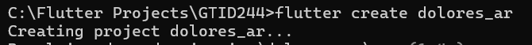
* **Instalar paquetes `camera`, `geolocator`, `flutter_compass` y `model_viewer_plus` (`Paso 0.1`):**
  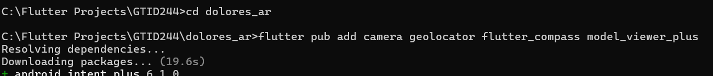

### Ronda 1 — ¿A qué distancia está? (Haversine)
* **🔴 Rojo — `test/ayudas_geo.dart` (`Ciclo 1.1`):**
  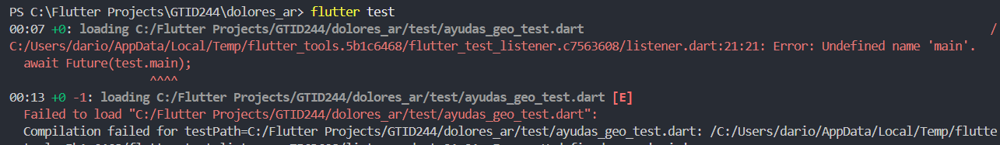
* **🔴 Rojo — `test/geo_test.dart` distancia (`Ciclo 1.1`):**
  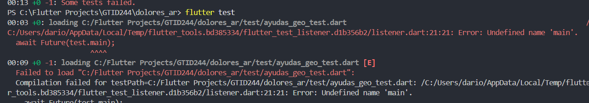
* **🟢 Verde — `distanciaMetros` (`Ciclo 1.2`):**
  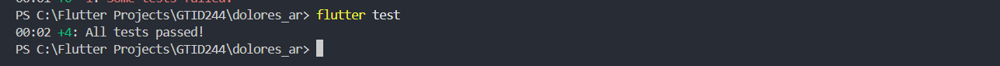

For help getting started with Flutter development, view the
[online documentation](https://docs.flutter.dev/), which offers tutorials,
samples, guidance on mobile development, and a full API reference.

[Manual_TDD_RealidadAumentada_Dolores.docx](https://github.com/user-attachments/files/34796554/Manual_TDD_RealidadAumentada_Dolores.docx)
=======
### Ronda 2 — ¿Hacia dónde queda? Rumbo y ángulos
* **🔴 Rojo — `rumboGrados` y `ángulos` (`Ciclo 2.1`):**
  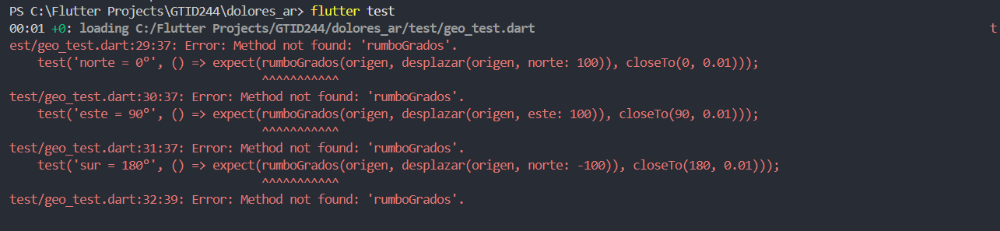
* **🟢 Verde — `rumboGrados` y suavizado (`Ciclo 2.2`):**
  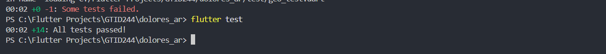

### Ronda 3 — De ángulo a pantalla: el campo de visión y catálogo
* **🔴 Rojo — `posicionHorizontal` y `formatearDistancia` (`Ciclo 3.1`):**
  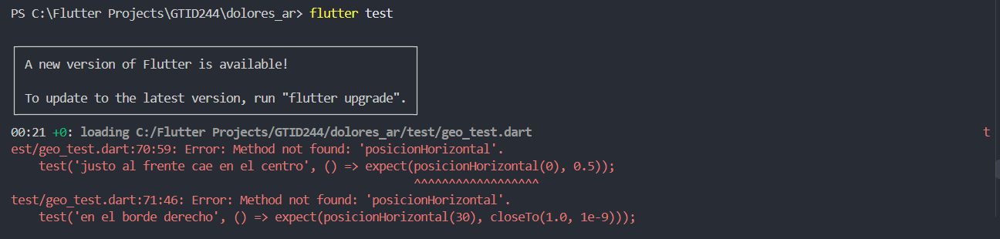
* **🟢 Verde — `posicionHorizontal` y `nombreCardinal` (`Ciclo 3.2`):**
  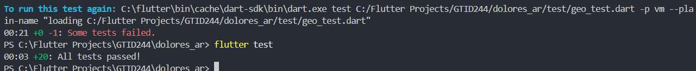
* **🟢 Verde — `lugar.dart` y `catalogo.dart` (`Ciclo 3.3`):**
  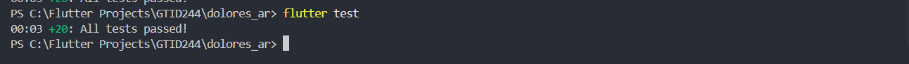

### Ronda 4 — El motor de realidad aumentada (`lib/dominio/motor_ar.dart`)
* **🔴 Rojo — `motor_ar_test.dart` (`Ciclo 4.1`):**
  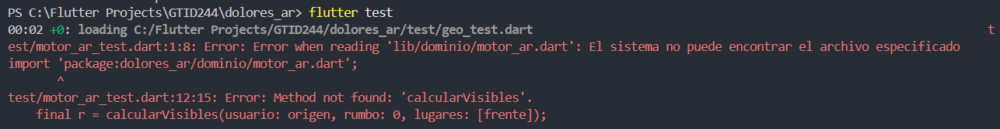
* **🟢 Verde — `calcularVisibles` (`Ciclo 4.2`):**
  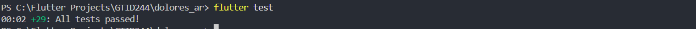

### Ronda 5 — El pasaporte turístico (`lib/dominio/pasaporte.dart`)
* **🔴 Rojo — `pasaporte_test.dart` (`Ciclo 5.1`):**
  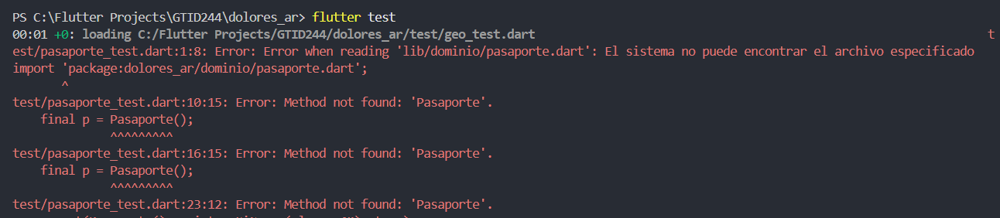
* **🟢 Verde — `Pasaporte` (`Ciclo 5.2`):**
  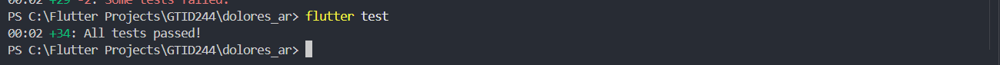

### Ronda 6 — Fuentes de datos y el ViewModel (`lib/presentacion/ar_viewmodel.dart`)
* **🔴 Rojo — `ar_viewmodel_test.dart` (`Ciclo 6.1`):**
  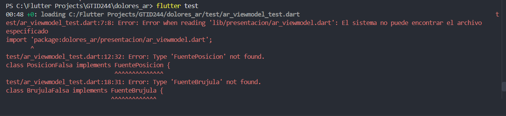
* **🟢 Verde — `ArViewModel` (`Ciclo 6.2`):**
  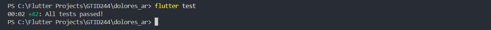
* **🟢 Pruebas de fuentes y simulación (`Paso 6.3`):**
  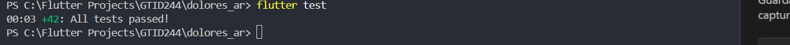

### Ronda 8 — RA de superficie: modelo 3D en tu espacio
* **Pantalla de inicio de `Dolores AR` (`Paso 8.2`):**
  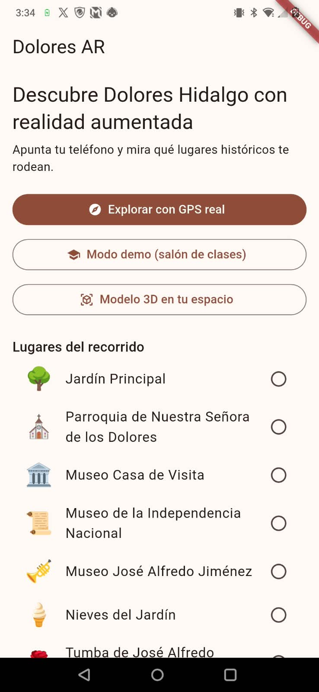
